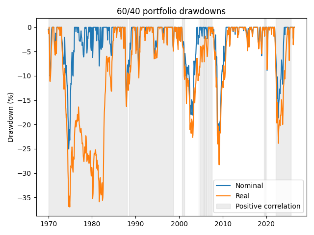
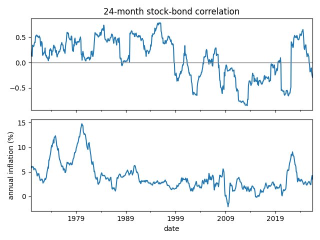

# Stock-bond correlation and the 60/40 portfolio, 1970-2026

How much a 60/40 portfolio protects you depends on the sign of the stock-bond correlation. When it was negative (2000-03 and 2007-09), bonds gained 21-31% while stocks fell, and the portfolio took 43-55% of the stock loss. In 2022 the correlation was positive, bonds fell together with stocks, and the portfolio took 97% of the stock loss.

Written for the course Asset Allocation and Investment Strategies (MSc Quantitative Finance, University of Warsaw), November 2026. This is my own part of a team homework.



## Data and method

- Source: monthly data from [Robert Shiller's dataset](https://shillerdata.com/), downloaded 30 Oct 2026, saved in `ie_data.xls`
- Period: the analysis covers January 1970 to June 2026 (678 months)
- The stock series is the S&P Composite index, including reinvested dividends
- The bond series estimates total returns from 10-year Treasury yields (GS10), including interest income and changes in bond prices
- CPI measures changes in consumer prices

The data's real stock and bond series have inflation already removed. I calculated their monthly returns and added inflation back using the monthly CPI ratio to obtain nominal returns. For each month, I calculated the correlation between the latest 24 monthly stock and bond returns.

The portfolio holds 60% stocks and 40% bonds. The weights reset at the beginning of each month. I calculated its monthly returns from a starting wealth value of 100.

## Correlation and inflation



Stock-bond correlation was positive from 1970 to September 1998, except for March-June 1988. From October 1998 to July 2007 its sign changed several times, and from July 2004 to July 2007 it was mostly positive but weak. It was negative without a break from August 2007 to June 2019. It was then close to zero, and negative from February 2020 to February 2022. It was positive from March 2022 to September 2025, and negative from October 2025 to June 2026.

Annual inflation is the 12-month change in CPI. Positive-correlation months had average annual inflation of 5.03%, and negative-correlation months had 2.22%. This indicates that the correlation is more often positive when the level of inflation is high. However, in the 1990s it was mostly positive with inflation of only about 3%.

## Portfolio losses

I grouped months by whether their rolling correlation is positive or negative. The table shows the max drawdowns observed in each group. All drawdowns were calculated from the continuous portfolio history before separating the months.

| Correlation regime | Months | Average annual inflation | Max nominal drawdown | Max real drawdown |
|---|---:|---:|---:|---:|
| Negative | 250 | 2.22% | -27.00% | -28.30% |
| Positive | 428 | 5.03% | -25.05% | -36.99% |

The max nominal drawdown was 27.00% in March 2009, during negative correlation. In positive-correlation months, the max nominal drawdown was 25.05%, reached in September 1974.

The comparison changes when inflation is included. The max real drawdown was 36.99% in December 1974, during positive correlation. During negative correlation the max real drawdown was 28.30% in March 2009.

To show what the sign of the correlation did, this table splits the four largest nominal drawdowns into stocks and bonds over the same months (`drawdown_breakdown.csv`). The last column shows how much of the stock loss the portfolio took.

| Drawdown | Regime at the bottom | Stocks | Bonds | 60/40 | 60/40 loss / stock loss |
|---|---|---:|---:|---:|---:|
| Jan 1973 to Sep 1974 | Positive | -39.00% | +0.62% | -25.05% | 64% |
| Aug 2000 to Feb 2003 | Negative | -41.56% | +31.29% | -18.05% | 43% |
| Oct 2007 to Mar 2009 | Negative | -49.04% | +20.95% | -27.00% | 55% |
| Dec 2021 to Oct 2022 | Positive | -19.26% | -18.02% | -18.64% | 97% |

In 2000-03 and 2007-09, when the correlation was negative, bonds rose while stocks fell, which made up for part of the stock loss. In 2022 both fell, so the portfolio took almost the whole stock loss: stocks fell less than half as much as in 2000-03, yet the portfolio lost slightly more. The largest nominal drawdown is still in the negative regime because stocks fell most in 2007-09, even with bonds helping.

## How to run

```bash
git clone https://github.com/konradaugustyn/stock-bond-correlation.git
cd stock-bond-correlation
pip install -r requirements.txt
python stock_bond_correlation.py
```

It reads `ie_data.xls` and saves the two charts, `regime_summary.csv` and `drawdown_breakdown.csv`.

## Limitations

Shiller's stock prices and GS10 yields are monthly averages, not month-end values, and this smoothing may minimize drawdowns. The Treasury returns are reconstructed estimates, so the results only approximate what a real portfolio would have earned. Costs and taxes are excluded.

A drawdown can start in one regime and reach its lowest point in another. The first table describes losses observed during each regime. The regimes also contain different numbers of months.
